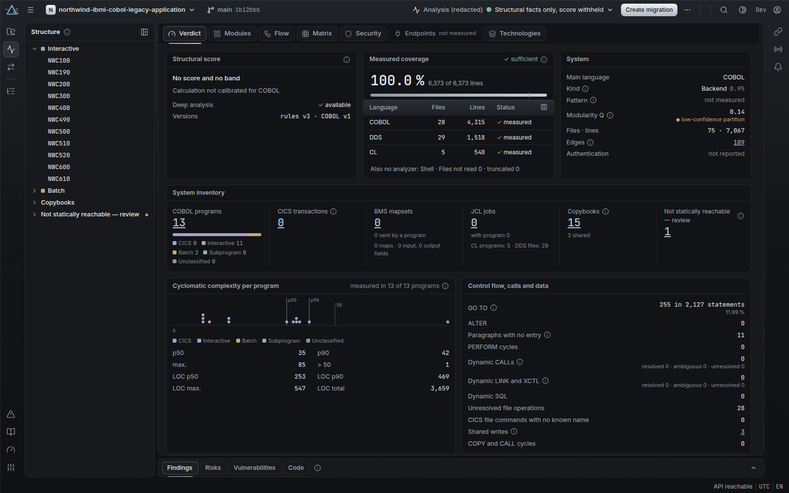
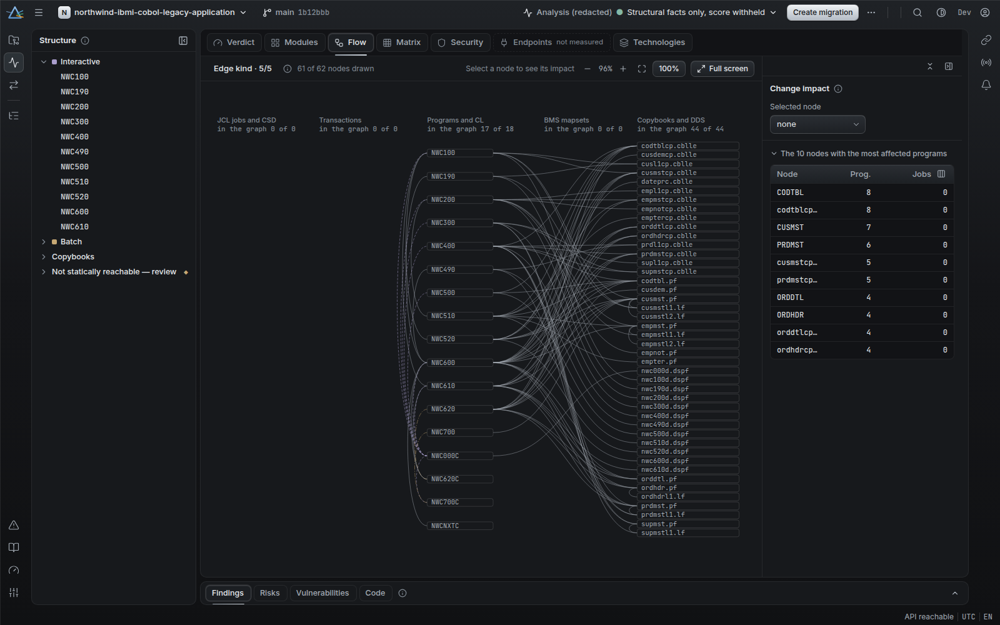
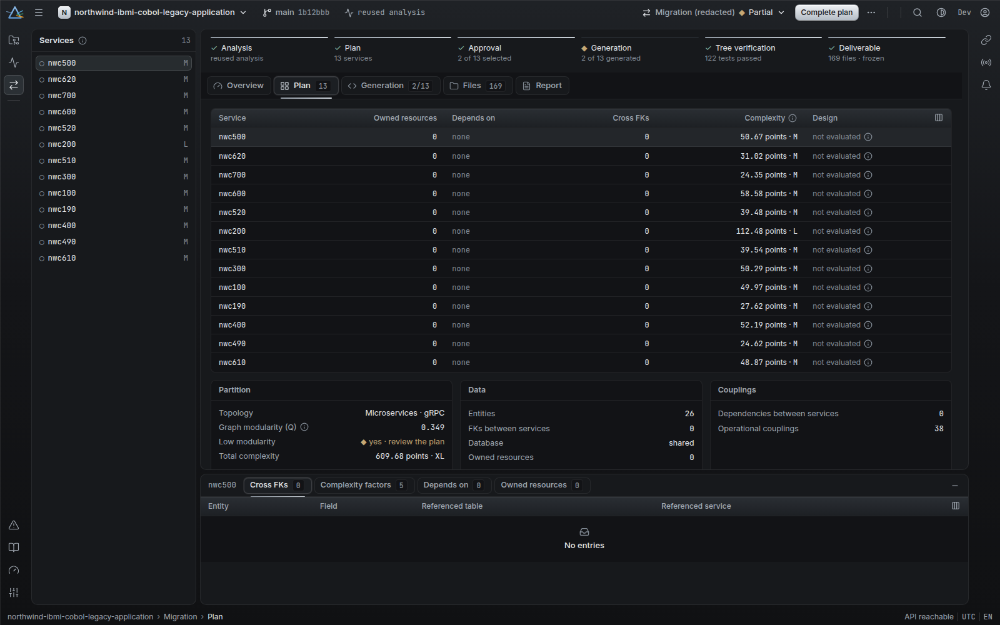
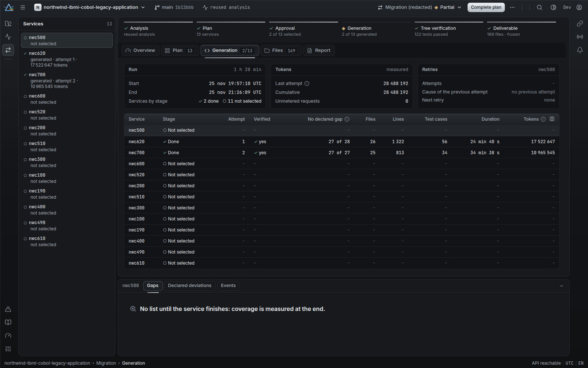
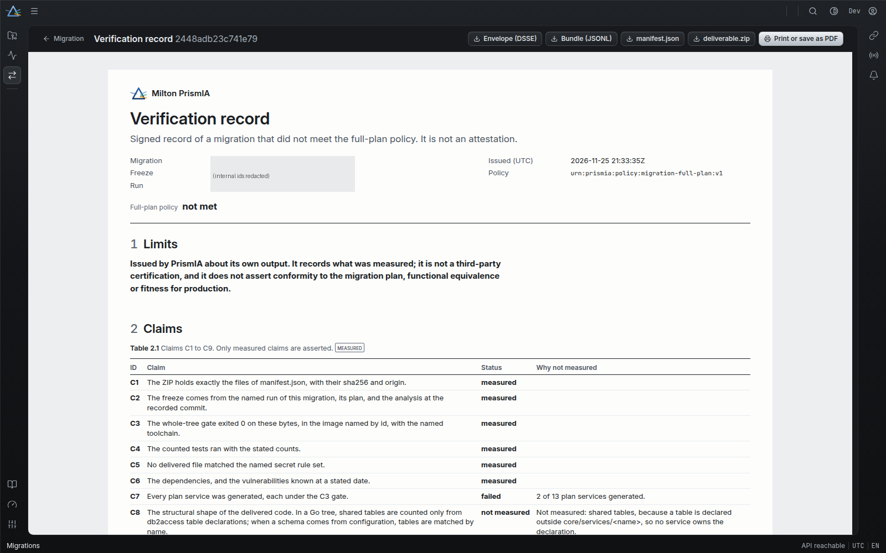

# northwind-cobol-to-go

Two IBM i COBOL batch programs from the [Northwind IBM i COBOL application](https://github.com/ZodandSons/northwind-ibmi-cobol-legacy-application) (upstream author's code, commit `1b12bbb76c7176247abbe58dfd87da40549767c4`, GPL-3.0) were converted by the Milton Prism migration platform into two Go gRPC services. An LLM-based agent wrote the Go code. The platform accepted the code after it passed the build, vet, test, module and vulnerability checks recorded in claims C3 and C4; the manifest, signature and golden checks were run afterwards and are reported below. In memory, the NWC620 invoice output matches the real COBOL output on 168 of 168 records. The NWC700 customer list matches on 186 of 188 records; the two that differ are two customers with equal sort keys, printed in swapped order. The same two services were also run against real Db2 for i on the PUB400 public IBM i host, through their own Db2 adapter on 2026-11-27: NWC620 168 of 168 identical, NWC700 186 of 188 identical, with the same two-record swap and no Db2 error from either service.

## What this is

- **NWC620** prints an invoice for one order. It is an ILE COBOL program (`qcbllesrc/nwc620.cblle` in the upstream repository). It reads the order header and lines, customer, product and code tables.
- **NWC700** prints a customer list grouped by country. It is an OPM COBOL/400 program (`qcblsrc/nwc700.cbl`). It reads every customer record and prints them sorted by country, city and company name. The Go port adds the customer number as a last sort key (see NWC700 below).
- Both programs are batch jobs. The two services issue no INSERT, UPDATE, DELETE or MERGE; the shared `pkg/db2access` package can build INSERT, UPDATE and DELETE statements, but no service code calls them.
- The generated code is in [`generated/`](generated/). It has 169 files, each listed with its SHA-256 hash (FIPS 180-4) in [`evidence/signature/manifest.json`](evidence/signature/manifest.json).
- The services are gRPC services over Db2 for i. Each service follows a hexagonal layout (`domain`, `application`, `ports`, `infrastructure`). See [`generated/README.md`](generated/README.md) for the layout and configuration.

## Screenshots

The screenshots come from the Milton Prism web panel. The product header in the images reads "Milton PrismIA". Internal record numbers were removed from the screenshots, and a development-account notice was hidden. Nothing else was changed. The same internal numbers do appear inside the signed files under [`evidence/signature/`](evidence/signature/), because editing those files would break the signature.



**1. Analysis overview.** Measured coverage is 100.0% (6,373 of 6,373 lines). The 13 COBOL programs are classified as 11 Interactive and 2 Batch. The structural score is withheld ("No score and no band"), because the calculation is not calibrated for COBOL.



**2. Analysis dependency graph.** The graph draws 61 of 62 nodes: 17 of 18 programs and CL members, and 44 of 44 copybooks and DDS files. The most used node is `CODTBL`, used by 8 programs.



**3. Migration plan.** The plan lists 13 services, and the Approval stage reads "2 of 13 selected". Tree verification reports 122 tests passed, and the deliverable reports 169 files frozen. Total complexity is 609.68 points, and the plan's low modularity flag asks for review.



**4. Generation results.** `nwc620` was generated on attempt 1: 26 files, 1,322 lines, 56 test cases and 17,522,647 tokens, verified. `nwc700` was generated on attempt 2: 25 files, 813 lines, 34 test cases and 10,965,545 tokens, verified. The reason for `nwc700`'s first attempt is in [Attempts the gates refused](#attempts-the-gates-refused).



**5. Signed verification record.** The full-plan policy reads "not met". Claims C1 to C6 are measured, C7 is failed ("2 of 13 plan services generated"), and C8 is not measured (shared tables). The image ends before C9.

## Results

| Result | Figure | Where it comes from |
|--------|--------|---------------------|
| Files in the deliverable | 169, all match the signed manifest | [`evidence/signature/manifest.json`](evidence/signature/manifest.json), checked by [`evidence/check_manifest.py`](evidence/check_manifest.py) (re-run for this README) |
| Archive SHA-256 | `7c51d0b491b5d085f93be7665c699da384a9b054ed8fa74946352c1c32b9c6a1` | [`evidence/signature/deliverable.zip`](evidence/signature/deliverable.zip), and the record's `zipSha256` in [`evidence/signature/attestation-2448adb23c741e79.json`](evidence/signature/attestation-2448adb23c741e79.json) (re-hashed for this README) |
| Signature | Valid. The Ed25519 signatures (RFC 8032) on the envelope and on the three bundle statements verify against the published key | Output of [`evidence/signature/verify_attestation.py`](evidence/signature/verify_attestation.py) (re-run for this README) |
| Signed verification record verdict | `verificationResult: FAILED` (see the limits) | `verificationResult` in the signed predicate, and the record file above |
| Build, vet, module verification, vulnerability scan | `go build ./...`, `go vet ./...`, `go mod verify` and `govulncheck ./...` all pass; govulncheck reports no vulnerabilities | Re-run for this README, not from a recorded log |
| Tests | 122 test runs: 90 top-level tests and 32 subtests; 0 failed, 0 skipped | `go test -count=1 -v ./...` (re-run for this README) |
| NWC620, in memory | 168 of 168 records byte-identical, on the same page and line | [`evidence/fidelity/nwc620-golden-compare-output.txt`](evidence/fidelity/nwc620-golden-compare-output.txt) (re-run, same output) |
| NWC700, in memory | 186 of 188 records identical. The 2 differences are explained below | [`evidence/fidelity/nwc700-golden-compare-output.txt`](evidence/fidelity/nwc700-golden-compare-output.txt) (re-run, same output) |
| NWC620, real Db2 for i | 168 of 168 records byte-identical, on the same page and line. Order 1006 is not on file: `NW2201`, no spooled file, as COBOL | [`evidence/fidelity-db2/README.md`](evidence/fidelity-db2/README.md) (run 2026-11-27) |
| NWC700, real Db2 for i | 186 of 188 records identical. The same 2 equal-key records are swapped | [`evidence/fidelity-db2/README.md`](evidence/fidelity-db2/README.md) (run 2026-11-27) |

### What the in-memory comparison covers

The comparison feeds the same CSV data that was loaded into the real IBM i files into the Go services. It then compares the spool output byte by byte with the spooled files that the real COBOL programs produced on PUB400.

Before comparing, the golden output has the PUB400 footer line `-=* https://pub400.com *=-` and the blank spacing lines removed. For NWC700, the empty first page that IBM i adds before the first heading is also removed, as described in [`evidence/golden-nwc700/README.md`](evidence/golden-nwc700/README.md). For NWC620, the empty first page is not removed. The runner checks that both sides have it, and counts a mismatch as a difference.

The in-memory repositories do not run any SQL, so these runs test the report logic only. The Db2 queries and the host's sort are tested by the real Db2 for i run in [`evidence/fidelity-db2/`](evidence/fidelity-db2/).

### NWC620: 168 of 168

Six orders were printed and compared: 1001, 1002, 1003, 1004, 1007 and 9999999. Order 1006 is not on file. The real program created no spooled file for it. The Go service returns `NW2201 Failure_Order_Not_Found` and writes no spool file; the runner counts that as a match.

The golden README in [`evidence/golden-nwc620/README.md`](evidence/golden-nwc620/README.md) lists seven differences. That section describes an earlier comparison of a previous build, and it is superseded. The current runner reports none, because the current build writes the empty first page and returns the not-found error for order 1006.

### NWC700: 186 of 188

Three customer sets were compared: `edge` (22 records), `empty` (3 records) and `pages` (163 records). The `empty` and `pages` sets match completely. The `edge` set has 2 differences.

The two differing records are customers `C0008` and `C0009`, both `TIE CO` in `TESTLAND` / `TESTVILLE`, with equal sort keys. The upstream SORT has no `WITH DUPLICATES IN ORDER` clause, so COBOL does not define the relative order of records with equal keys. The host printed them in arrival order, the Go service by customer number; the source program guarantees neither. The statement is at [`qcblsrc/nwc700.cbl`, lines 115-116](https://github.com/ZodandSons/northwind-ibmi-cobol-legacy-application/blob/1b12bbb76c7176247abbe58dfd87da40549767c4/qcblsrc/nwc700.cbl#L115-L116). Everything else matches, including the page breaks in the `pages` set and the EBCDIC order of lower-case and digit characters.

## Attempts the gates refused

The platform refused several generation attempts before it accepted the code. The full record is in [`evidence/generation-attempts.md`](evidence/generation-attempts.md). Its facts come from the platform's generation-worker logs and run records, which are not public. Two examples:

- In this build, `nwc700`'s attempt 1 was refused by the structural gate for a `toolchain` line in `go.mod`. Attempt 2 passed.
- In an earlier run of the same two services, `nwc620` failed all 3 attempts. In attempt 1 the agent wrote files outside its scope, and the scope check refused them. In attempts 2 and 3 the COBOL decimal gate refused a test that decoded a number into an `any` value.

## Verify it yourself

Run these commands from the root of this repository. You need `sha256sum`, `python3`, `unzip`, and Go 1.27 or newer. `go.mod` declares `go 1.27.0`; the verification was done with go1.27.4.

**1. Hash the archive.** The output should be `7c51d0b491b5d085f93be7665c699da384a9b054ed8fa74946352c1c32b9c6a1`.

```sh
sha256sum evidence/signature/deliverable.zip
```

**2. Verify the signatures of the signed verification record.** The verifier takes the directory and the record id, in that order. It opens the archive under the name `deliverable.zip.raw`, so copy the signature folder to a new directory and rename the archive there. The verifier needs the Python `cryptography` package (`pip install cryptography`).

```sh
work=$(mktemp -d)
cp evidence/signature/* "$work"/
mv "$work/deliverable.zip" "$work/deliverable.zip.raw"
python3 -I evidence/signature/verify_attestation.py "$work" 2448adb23c741e79
```

Expected output: `envelope: signature valid, subject deliverable.zip = 7c51d0b491b5d085f93be7665c699da384a9b054ed8fa74946352c1c32b9c6a1`, `bundle: statements with valid signatures: 3`, then one line per claim. Claims C7 and C8 are reported as `FAILED` and `NOT_MEASURED` (see the limits). If you run the verifier on `evidence/signature/` without the rename, it stops with `FileNotFoundError: ... deliverable.zip.raw`.

**3. Check every file under `generated/` against the manifest.** `evidence/check_manifest.py` compares the size and SHA-256 of each file listed in `manifest.json`, and reports any file that is missing or not listed. Archives are not rebuilt byte for byte here, so this check is the way to confirm the tree.

```sh
python3 -I evidence/check_manifest.py
```

Expected output: `OK: 169 files under generated/ match manifest.json (sha256, size); no extra files`, exit code 0.

**4. Compare the archive with `generated/`.** This unpacks the signed archive into a new directory and compares it with the tree.

```sh
d=$(mktemp -d)
unzip -q evidence/signature/deliverable.zip -d "$d"
diff -r "$d" generated && echo "identical"
```

Expected output: `identical`.

**5. Build and test the generated code.** The first run needs network access, or a populated Go module cache, to download the modules listed in `generated/go.mod`.

```sh
cd generated && go build ./... && go test ./...
```

Expected output: 11 packages with tests report `ok`, and the rest report `[no test files]`. To count the test runs: `go test -count=1 -v ./... | grep -c '=== RUN'` prints 122. The other static checks:

```sh
cd generated && go vet ./... && go mod verify
govulncheck ./...
```

`govulncheck` is installed with `go install golang.org/x/vuln/cmd/govulncheck@latest`, and it needs its vulnerability database. The signed record's claim C3 ran the same checks with a local vulnerability database; the run for this README used the online database. The run reported "No vulnerabilities found" in this environment on 2026-11-27. Its behaviour without network access was not tested.

The deliverable's `Makefile` has a `build` target that writes binaries under `generated/core/`. It was not run, so do not use it for these checks.

**6. Re-run the in-memory comparisons.** The runners are stored as `.go.txt` files, so the repository does not build them as part of `generated/`. The commands below copy the tree to a new directory, add the runners there, and run them. The copy is never written back to `generated/`.

```sh
REPO=$(pwd)
W=$(mktemp -d)
cp -r "$REPO/generated" "$W/mod"
mkdir -p "$W/mod/cmd/goldencompare620" "$W/mod/cmd/goldencompare700"
cp "$REPO/evidence/fidelity/goldencompare620.go.txt" "$W/mod/cmd/goldencompare620/main.go"
cp "$REPO/evidence/fidelity/goldencompare700.go.txt" "$W/mod/cmd/goldencompare700/main.go"
cd "$W/mod"
go run ./cmd/goldencompare620 "$REPO/evidence/golden-nwc620"
go run ./cmd/goldencompare700 "$REPO/evidence/golden-nwc700"
```

Expected final lines: `TOTAL records compared: 168, identical: 168, differing items: 0` and `TOTAL records compared: 188, identical: 186, differing items: 2`. The stored outputs are in [`evidence/fidelity/`](evidence/fidelity/).

Both Db2 runners ran on 2026-11-27 against PUB400 and their output is in [`evidence/fidelity-db2/`](evidence/fidelity-db2/). Both need the PUB400 host and a password file.

## Naming

The generated code uses the Go module path `milton_prism` (see `generated/go.mod`), which carries the name of the tool, Milton Prism. It was left as it is, because the signed manifest records the SHA-256 of every file, and changing any file would break the match with the signature.

## Licence

This repository is licensed under the GNU General Public License v3.0 (see [`LICENSE`](LICENSE)). The generated code is derived from the Northwind IBM i COBOL application, which is GPL-3.0. The original COBOL programs, DDS sources and copybooks are the work of the upstream author: [northwind-ibmi-cobol-legacy-application](https://github.com/ZodandSons/northwind-ibmi-cobol-legacy-application), commit `1b12bbb76c7176247abbe58dfd87da40549767c4`.

## What depends on others

- **PUB400**, a free public IBM i host, ran the golden programs and was the target of the Db2 run on 2026-11-27.
- **The upstream Northwind author's code** supplies the COBOL source, the DDS and the copybooks. The golden runs compiled them unchanged.
- **The Go module proxy** supplies the modules in `generated/go.mod` on the first build.
- **The vulnerability database** used by `govulncheck` supplies the vulnerability result.
- **The Python `cryptography` package** does the Ed25519 checks in `verify_attestation.py`.

The golden runs used a small synthetic data set (the CSV files in `evidence/golden-nwc620/` and `evidence/golden-nwc700/`), not real customer or order data. The golden runs were made on 2026-11-24 (NWC620) and 2026-11-25 (NWC700). The PUB400 user profile appears in the golden-run files, which are kept as they were produced.

## Limits

- **Two of 13 planned programs.** Only NWC620 and NWC700 were generated. The signed record lists the other 11 plan services (nwc100, nwc190, nwc200, nwc300, nwc400, nwc490, nwc500, nwc510, nwc520, nwc600, nwc610) as `not_selected`. The generated README names them too. Their code is not in this repository.
- **Both programs are batch jobs.** Neither is an interactive (5250) program.
- **The Db2 for i run covers one host and one synthetic data set.** The runs used the golden CSV data on PUB400, with DB2_COMMIT_MODE=*NONE. Real order and customer data, other data volumes and other IBM i systems were not tested. The earlier attempt on 2026-11-25 failed at its first connection, before any statement reached the host.
- **The NWC700 difference is real on the host too.** The 2 records `C0008` and `C0009` are swapped, as described above. The Db2 run gave the same swap, because the port's SQL sorts equal keys by customer number. The COBOL source does not define the order of equal keys.
- **The signed verification record FAILED.** It is a verification record, not an attestation, because the full-plan policy was not met: only 2 of 13 plan services were generated. The record's top-level `verificationResult` is `FAILED`. Its claim `C7` is `FAILED` with the reason "2 of 13 plan services generated". The record's `notIssuableReason` reads: "ATTESTATION_PARTIAL_PLAN: partial plan: 2 of 13 plan services generated, migration state MIGRATION_STATE_PARTIAL".
- **Claim `C8` was not measured.** Its reason is "not measured: sharedTables (a table is declared outside core/services/<name>, so no service owns the declaration)". The shared-table part of the structural check did not run. The other figures in `C8` (2 services, 0 cycles, 0 inter-service edges) are in the record.
- **First-party, not third-party.** The signed verification record is issued by the platform about its own output. It records what was measured, it "is not a third-party certification", and it "does not assert conformity to the migration plan, functional equivalence or fitness for production." The files named `attestation-*` in `evidence/signature/` belong to this record. A valid signature shows that the key in `attestation_keys.json` signed these exact bytes. It does not show that the code is correct.
- **The services need configuration before they start.** The deliverable's README notes that `SERVICE_TIME_ZONE` is empty and each service refuses to start until it is set. `DB2_CCSID` and `DB2_COMMIT_MODE` are also required. See [`generated/README.md`](generated/README.md).
- **The in-memory runs do not test Db2.** They test the report logic against the real output. The Db2 queries and the host's sort were tested only by the 2026-11-27 run.

The next concrete step is a decision on the equal-key order of NWC700. Either record the customer-number tie-break as an accepted, documented difference, or change the port's sort and re-run `db2realrun700` as described in [`evidence/fidelity-db2/README.md`](evidence/fidelity-db2/README.md).
